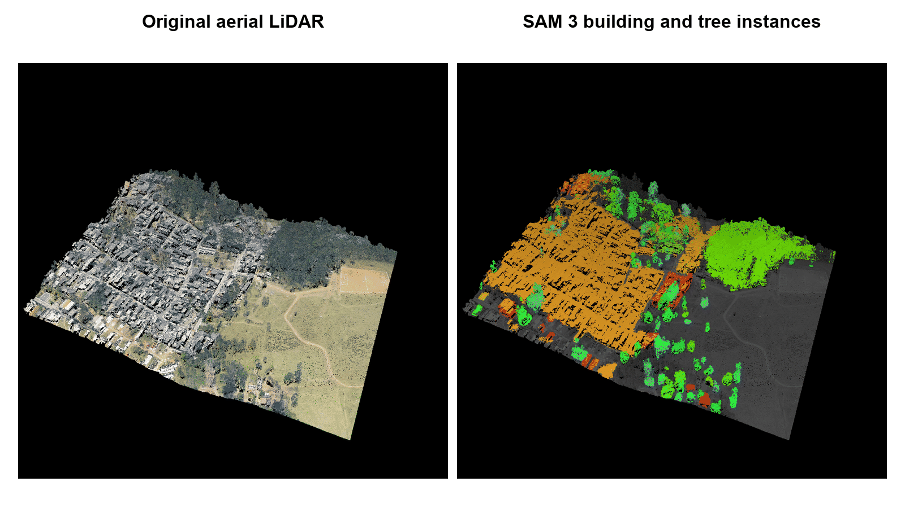

# segment-lidar

[](https://github.com/Yarroudh/segment-lidar/blob/main/LICENSE)
[](http://geomatics.ulg.ac.be/)
[](https://yarroudh.github.io/segment-lidar/)


*Python package for instance segmentation of aerial LiDAR data using the
Segment Anything Model 3 from Meta AI.*

`segment-lidar` projects a 3D point cloud into an image, uses SAM 3 to find
objects, and transfers the instance labels back to the original points. It
supports automatic mask generation, text prompts, box prompts, top views,
pinhole cameras, saved label rasters, ground filtering, and LAS or LAZ output.



This animation shows a real SAM 3 result on a tile from the
[Sao Paulo M3DC aerial LiDAR archive](https://registry.opendata.aws/pmsp-lidar/).
The source has 5,556,802 RGB points. The `buildings` prompt found 28 masks and
the `tree` prompt found 96 masks. After resolving overlap, the result contains
28 building instances, 87 visible tree instances, and 2,907,279 labeled source
points. Both views use the same rotating perspective camera so the 3D structure
remains visible.

The 0.3 series uses the gated
[facebook/sam3 model on Hugging Face](https://huggingface.co/facebook/sam3).
Inference runs locally after the model files are downloaded.

## Installation

Use Python 3.10 or newer. A CUDA GPU is recommended for SAM 3 inference.
Install the package and its SAM 3 dependencies from PyPI:

```bash
python -m pip install "segment-lidar[sam3]"
```

You can also install the current source version:

```bash
git clone https://github.com/Yarroudh/segment-lidar
cd segment-lidar
python -m pip install -e ".[sam3]"
```

Ground filtering is optional:

```bash
python -m pip install "segment-lidar[csf]"
```

## Documentation

Read the complete [documentation](https://yarroudh.github.io/segment-lidar/)
for detailed usage guidance. The
[basic tutorial](https://yarroudh.github.io/segment-lidar/tutorial.html) and
[API reference](https://yarroudh.github.io/segment-lidar/module.html) describe
the available parameters.

The [migration guide](https://yarroudh.github.io/segment-lidar/migration.html)
explains changes from the earlier SAM 1 documentation.

## Basic tutorial

Set `HF_TOKEN` before the first SAM 3 inference call. The
[Model access](#model-access) section explains how to request access and create
a token.

### Without ground filtering

With no prompt, `segment` uses automatic mask generation to find instances
across the projected image.

```python
from segment_lidar import SamLidar, TopView

viewpoint = TopView()
model = SamLidar(resolution=0.25)
points = model.read("pointcloud.las")
segment_ids, labels, image = model.segment(
    points,
    view=viewpoint,
    image_path="raster.tif",
    labels_path="labels.tif",
)
model.write(points, segment_ids, save_path="segmented.las")
```

The label raster uses 0 for the background and positive integers for object
instances. Points on the background or outside the image receive `-1`.

### With ground filtering

```python
from segment_lidar import SamLidar, TopView

viewpoint = TopView()
model = SamLidar(resolution=0.25)
points = model.read("pointcloud.las")
cloud, non_ground, ground = model.csf(points)
segment_ids, labels, image = model.segment(
    cloud,
    view=viewpoint,
    image_path="raster.tif",
    labels_path="labels.tif",
)
model.write(
    points,
    segment_ids,
    non_ground=non_ground,
    ground=ground,
    save_path="segmented.las",
)
```

The indices returned by `csf` refer to the original cloud. The writer preserves
the point order and adds a signed 32 bit `segment_id` dimension.

### Text prompts

Use a text prompt to find every visible instance of a concept:

```python
segment_ids, labels, image = model.segment(points, prompt="building")
```

`model.text_prompt.score_threshold` and
`model.text_prompt.mask_threshold` control the result. Both accept values from
0 to 1 and default to 0.5.

### Box prompts

Boxes use image pixel coordinates in the order
`[left, top, right, bottom]`. A label of 1 marks a positive box and 0 marks a
negative box. Text and boxes can be combined.

```python
import numpy as np

segment_ids, labels, image = model.segment(
    points,
    prompt="tree",
    boxes=np.array([[80, 40, 180, 220], [210, 30, 300, 160]]),
    box_labels=np.array([1, 0]),
)
```

A positive box also works without text. With no text or boxes, the library
uses automatic mask generation.

### Saved label rasters

Saved labels can be transferred to a point cloud without loading SAM 3 or
providing a Hugging Face token. Provide a three band RGB raster and a single
band integer label raster with matching dimensions.

```python
model = SamLidar(resolution=0.25)
segment_ids, labels, image = model.segment(
    points,
    image_path="raster.tif",
    labels_path="labels.tif",
    image_exists=True,
    label_exists=True,
)
```

New top view GeoTIFF files include a spatial transform. This allows a subset
of the original cloud to use a saved image and label raster.

### Pinhole camera

For camera geometry, numeric projection examples, and a complete saved-raster
workflow, see the [pinhole camera guide](https://yarroudh.github.io/segment-lidar/pinhole.html).

The package supports a custom pinhole camera. `rotation` and `translation`
transform world points into camera coordinates. `intrinsics` is a 3 by 3
camera matrix.

```python
import numpy as np

from segment_lidar import PinholeView, SamLidar

intrinsics = np.array([[500, 0, 256], [0, 500, 256], [0, 0, 1]])
model = SamLidar(
    intrinsics=intrinsics,
    rotation=np.eye(3),
    translation=np.zeros(3),
    width=512,
    height=512,
)
segment_ids, labels, image, intrinsics, pose = model.segment(
    points,
    view=PinholeView(),
    prompt="tree",
)
```

The nearest point appears at each pixel. The optional `distance_threshold`
measures positive camera depth.

## Sample data

The release animation uses the RGB aerial LiDAR tile
[MDS_color_2222-212.laz](https://laz-m3dc-pmsp.s3.sa-east-1.amazonaws.com/MDS_color_2222-212.laz)
from the [Sao Paulo M3DC archive](https://registry.opendata.aws/pmsp-lidar/).
The archive provides many urban tiles with buildings, trees, roads, and other
objects. Review the dataset page for its license and attribution requirements.

The animation source, parameters, and attribution are recorded in
[assets/README.md](assets/README.md).

## Model access

SAM 3 is gated on Hugging Face. A token does not grant access by itself. Use
the same Hugging Face account for the access request and the token:

1. Sign in to Hugging Face and open the
   [facebook/sam3 model page](https://huggingface.co/facebook/sam3).
2. Read the conditions, submit the access request, and agree to share the
   requested account information with Meta.
3. Wait until access is approved. Approval may be immediate or may require a
   review by the model owner.
4. Create a [Hugging Face token](https://huggingface.co/settings/tokens) with
   read access to the model. A token limited to this model is preferable.
5. Provide the token through `HF_TOKEN` or the `hf_token` argument of
   `SamLidar`.

For a shell session, enter the token without displaying it:

```bash
read -rs HF_TOKEN
export HF_TOKEN
```

Do not put a real token in a script, notebook, Docker image, or commit. If
access is pending, the library reports a permission error with a link to the
model page. Access requests must be completed on Hugging Face.

Manual SAM 1 checkpoint downloads are no longer used. The Hugging Face client
downloads the SAM 3 files into its local cache when inference starts.

## Docker Image

The repository includes a Docker image for the SAM 3 runtime. The model files
are downloaded when inference starts, so the token is supplied when the
container runs rather than when the image is built.

These are the steps to run `segment-lidar` in a Docker container:

1. Build the current image from the repository:

```bash
docker build -t segment-lidar:local .
```

2. Create a local `.env` file containing your approved Hugging Face token:

```text
HF_TOKEN=your_token_here
```

3. Put your data and processing script in a local `data` directory. Run the
   script with a GPU and mount that directory at `/data`:

```bash
docker run --rm --gpus all --env-file .env \
  -v "$PWD/data:/data" segment-lidar:local python /data/process.py
```

Output written to `/data` is immediately available in the local `data`
directory. Docker needs the NVIDIA container runtime for `--gpus all`.

4. For CPU inference, omit `--gpus all`. SAM 3 can be slow on a CPU:

```bash
docker run --rm --env-file .env \
  -v "$PWD/data:/data" segment-lidar:local python /data/process.py
```

Use `--build-arg INSTALL_EXTRAS=` during the build to create a smaller image
for projection and saved label workflows that do not load SAM 3.

## Development

Install the development dependencies and run the project checks:

```bash
python -m pip install -e ".[test]"
ruff check segment_lidar tests scripts
ruff format --check segment_lidar tests scripts
pytest -q
python -m build
```

To reproduce the animation, download the sample tile and run:

```bash
python scripts/make_animation.py --sample /path/to/MDS_color_2222-212.laz
```

The generator reads `HF_TOKEN` from the environment or a local `.env` file.
It runs separate `buildings` and `tree` prompts, preserves their instance
labels, and renders the synchronized rotating views. Repeat `--prompt` to use
other concepts. Use `--labels` with a saved combined label raster to render
the animation without repeating inference.

## Related repositories

We acknowledge the creators and maintainers of:

- [SAM 3](https://github.com/facebookresearch/sam3)
- [SAM 3 on Hugging Face](https://huggingface.co/facebook/sam3)
- [segment-geospatial](https://github.com/opengeos/segment-geospatial)

These projects provide the segmentation model and geospatial work that
informed the development of this package.

## License

This software uses the BSD 3 Clause New or Revised license. This permissive
license allows broad use of the software as long as the copyright and license
notice are included. Refer to the [LICENSE](LICENSE) file for the complete
terms.

## Citation

If you use this repository in research, cite it with the accompanying
[BibTeX citation](CITATION.bib):

```bibtex
@misc{yarroudh:2023:samlidar,
  author = {Yarroudh, Anass},
  title = {LiDAR Automatic Unsupervised Segmentation using Segment-Anything Model (SAM)},
  year = {2023},
  howpublished = {GitHub Repository},
  url = {https://github.com/Yarroudh/segment-lidar}
}
```

Yarroudh, A. (2023). *LiDAR Automatic Unsupervised Segmentation using
Segment Anything Model (SAM)*. GitHub repository.

## Author

This software was developed by
[Anass Yarroudh](https://www.linkedin.com/in/anass-yarroudh/), a Research
Engineer in the
[Geomatics Unit of the University of Liege](http://geomatics.ulg.ac.be/fr/home.php).
For more information, contact <ayarroudh@uliege.be>.

---

Copyright 2023, [Geomatics Unit of ULiège](http://geomatics.ulg.ac.be/fr/home.php).
Released under the [BSD 3 Clause License](LICENSE).
