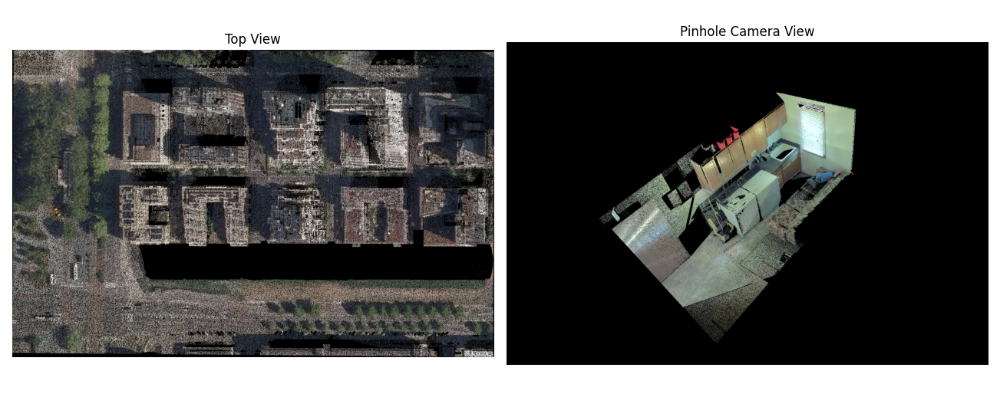

Pinhole camera guide
====================

A pinhole view gives a perspective image from a chosen camera. It is useful
for facades, individual trees, and oblique scenes where a top view hides
vertical structure. The camera is supplied as numerical matrices through
``SamLidar``; ``PinholeView(interactive=True)`` currently raises
``NotImplementedError``.

The two views above illustrate their different camera geometry. They are
historical project examples, rather than output of the current SAM 3 model.

Coordinate convention
---------------------

For a world point ``X_world = [x, y, z]``, the camera coordinates are

.. math::

   X_\mathrm{camera} = R X_\mathrm{world} + t.

``rotation`` is the 3 by 3 world-to-camera matrix ``R`` and ``translation``
is the three element vector ``t``. They are **not** the camera-to-world pose.
To place the camera center at world coordinate ``C``, compute
``t = -R @ C``. The returned 4 by 4 ``pose`` has ``R`` in its upper left and
``t`` in its upper right; it is also world-to-camera.

Camera ``+Z`` points forward, ``+X`` points right, and ``+Y`` points down in
the image. Only points with positive camera Z are projected. The 3 by 3
intrinsic matrix is typically

.. math::

   K = \begin{bmatrix} f_x & 0 & c_x \\ 0 & f_y & c_y \\ 0 & 0 & 1 \end{bmatrix}.

``fx`` and ``fy`` are focal lengths in **pixels**; ``cx`` and ``cy`` are the
principal point in image pixels. The image origin is at its upper left. The
implementation computes ``u = fx*X/Z + cx`` and ``v = fy*Y/Z + cy`` for this
standard matrix, then floors both coordinates to choose an integer pixel.
It also accepts an upper-left 2 by 2 skew term. The image size is set by
``width`` and ``height`` on ``SamLidar``; both default to 512. Choose
``cx=width/2`` and ``cy=height/2`` for a centered principal point.
``resolution`` applies only to top views and does not set pinhole pixel size.

Numerical example
-----------------

Place the camera at ``C = (0, 0, 10)`` and point it straight down toward
world ``-Z``. With world Y increasing upward in the desired image, use
``R = diag(1, -1, -1)`` and ``t = -R @ C = (0, 0, 10)``. Let
``fx=fy=500``, ``cx=320``, and ``cy=240`` for a 640 by 480 image.

The point ``(1, 1, 0)`` becomes camera point ``(1, -1, 10)``. It lands at
``u = 500*1/10+320 = 370`` and ``v = 500*(-1)/10+240 = 190``. The point
``(0, 0, 11)`` has camera depth ``-1`` and is discarded because it is behind
the camera.

Run the projection without downloading a model:

.. code-block:: python

   import numpy as np
   from segment_lidar import PinholeView

   points = np.array([
       [1, 1, 0, 1, 0, 0],   # red, projected to (370, 190)
       [0, 0, 0, 0, 1, 0],   # green, projected to (320, 240)
       [0, 0, 11, 0, 0, 1],  # behind the camera
   ], dtype=float)
   K = np.array([[500, 0, 320], [0, 500, 240], [0, 0, 1]], dtype=float)
   R = np.diag([1.0, -1.0, -1.0])
   camera_center = np.array([0.0, 0.0, 10.0])
   t = -R @ camera_center

   view = PinholeView()
   image, intrinsics, pose = view.cloud_to_image(
       points, intrinsics=K, rotation=R, translation=t,
       width=640, height=480,
   )
   assert image[190, 370].tolist() == [255, 0, 0]
   assert image[240, 320].tolist() == [0, 255, 0]
   assert image[240, 370].tolist() == [0, 0, 0]

Segmentation of a real cloud
----------------------------

The following complete example looks down at the XY center of a cloud from
30 world units above its highest point. Adjust the focal length, camera
height, and orientation after inspecting the saved RGB raster. It runs SAM 3
and needs approved model access as described in :doc:`installation`.

.. code-block:: python

   import numpy as np
   from segment_lidar import PinholeView, SamLidar

   model = SamLidar()
   points = model.read("pointcloud.las")
   width, height = 1024, 768
   center_xy = (points[:, :2].min(axis=0) + points[:, :2].max(axis=0)) / 2
   camera_center = np.array([*center_xy, points[:, 2].max() + 30.0])
   R = np.diag([1.0, -1.0, -1.0])
   t = -R @ camera_center
   K = np.array([
       [700.0, 0.0, width / 2],
       [0.0, 700.0, height / 2],
       [0.0, 0.0, 1.0],
   ])

   model.intrinsics, model.rotation, model.translation = K, R, t
   model.width, model.height = width, height
   ids, labels, image, K_used, pose = model.segment(
       points,
       view=PinholeView(),
       prompt="tree",
       image_path="results/pinhole_rgb.tif",
       labels_path="results/pinhole_labels.tif",
   )
   model.write(points, ids, save_path="results/pinhole_segments.las")

``K_used`` and ``pose`` are the matrices actually used for projection. Keep
them with the raster if you plan to transfer its labels again. For a wider
scene, lower ``fx`` and ``fy`` or move the camera farther away. Pixels outside
the image and points behind the camera receive ``-1``.

Visibility and label transfer
-----------------------------

For each pixel, the RGB image shows the **nearest positive-depth point**.
Other points at the same pixel do not supply color. During label transfer,
however, all points projecting to a labeled pixel receive that label,
including points hidden behind the visible surface. Use additional views or
3D checks if this matters for your analysis. Empty RGB pixels are black.

``distance_threshold`` is an optional upper limit on **positive camera Z**,
in the same units as the input coordinates. It is not Euclidean distance from
the camera. The same threshold is used during projection and label transfer:

.. code-block:: python

   model.distance_threshold = 50.0

The camera matrices must contain finite values, ``fx`` and ``fy`` must be
positive, and image dimensions must be positive. Inputs of shape ``(N, 3)``
without RGB are rendered white.

Reuse a pinhole label raster
----------------------------

Pinhole GeoTIFFs have no spatial transform that can recover the camera. To
reuse a saved RGB and label pair, supply **the same** ``K``, ``R``, ``t``,
and ``distance_threshold`` that created it. The cached image determines the
image dimensions; the current ``width`` and ``height`` are used only when
generating a new image. No SAM 3 token is needed in this example:

.. code-block:: python

   from segment_lidar import PinholeView, SamLidar

   cached = SamLidar(
       intrinsics=K_used,
       rotation=pose[:3, :3],
       translation=pose[:3, 3],
       distance_threshold=model.distance_threshold,
   )
   subset = points[:1000]
   ids, labels, image, _, _ = cached.segment(
       subset,
       view=PinholeView(),
       image_path="results/pinhole_rgb.tif",
       labels_path="results/pinhole_labels.tif",
       image_exists=True,
       label_exists=True,
   )

The RGB raster must have three bands, the label raster one band, and their
pixel dimensions must match. Background label 0 becomes point label -1.
